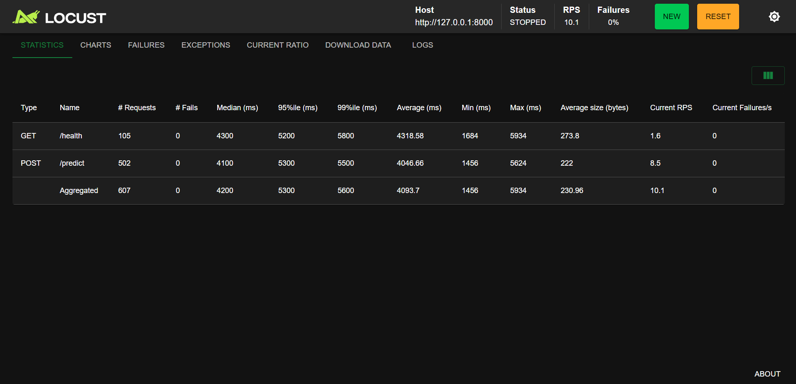
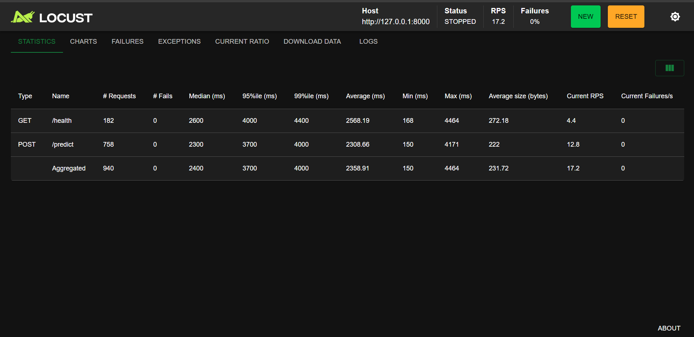
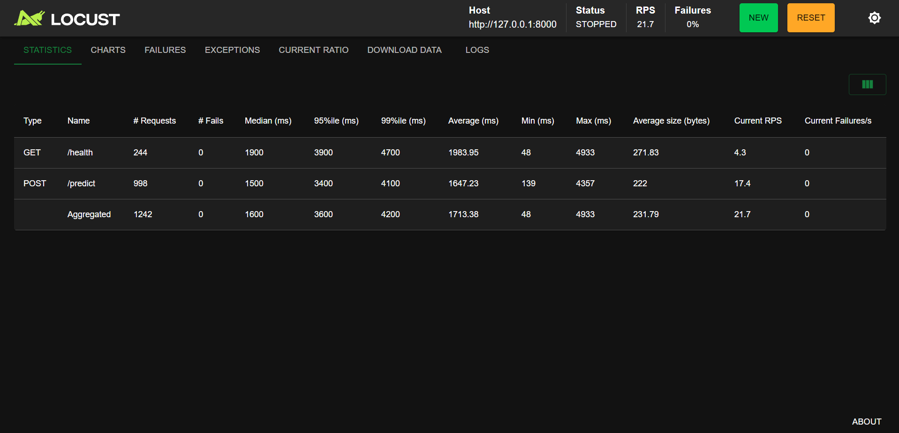

# Crop Classification MLOps 

[](https://www.python.org/)
[](https://www.tensorflow.org/)
[](https://fastapi.tiangolo.com/)
[](https://streamlit.io/)
[](https://www.docker.com/)

## 1. Project Overview

The **Introduction to Machine Learning** summative (`crop_classification_project_summative.ipynb`) addressed **7-class agricultural crop classification** using **174 tabular fused optical-radar sensor features** (`WinnipegDataset.txt`), achieving **99.79% test accuracy** with XGBoost and **99.77%** with a baseline Keras neural network while identifying canopy spectral overlap and class imbalance as core domain challenges.

This **MLOps Summative** extends that agricultural crop classification pipeline from tabular sensor readings to **non-tabular 2D RGB crop imagery (`224x224x3`)** across five crop classes (`cotton`, `maize`, `rice`, `soyabean`, `wheat`), packaged into a multi-container service with live inference, SQLite audit logging, and continuous retraining.

### Live Deployment & Walkthrough
* **Live Streamlit Web App:** [http://82.29.184.200:8501](http://82.29.184.200:8501)
* **Live FastAPI Swagger Docs:** [http://82.29.184.200:8005/docs](http://82.29.184.200:8005/docs)
* **Video Demo:** [https://youtu.be/bTOmNvEYwGY](https://youtu.be/bTOmNvEYwGY)

---

## 2. System Architecture & MLOps Workflow

```text
+-------------------+       HTTP :8501        +-------------------------------+
|  End User /       | ----------------------> |  Streamlit Web Dashboard      |
|  Agronomist       |                         |  (ui.py)                      |
+-------------------+                         +---------------+---------------+
                                                              | Internal HTTP (http://nginx:80)
+-------------------+   HTTP :8005 (VPS) /    +---------------v---------------+
|  Locust Load      |   :8000 (Local)         |  Nginx Reverse-Proxy LB       |
|  Simulator        | ----------------------> |  (Dynamic Docker DNS)         |
+-------------------+                         +---------------+---------------+
                                                              | Round-Robin Load Balancing
                                     +------------------------+------------------------+
                                     v                                                 v
                     +-------------------------------+                 +-------------------------------+
                     |  FastAPI Worker 1..N (app.py) |                 |  FastAPI Worker N (app.py)    |
                     |  - MobileNetV2 Inference      |                 |  - MobileNetV2 Inference      |
                     |  - Auto Hot-Reload (.h5 mtime)|                 |  - Auto Hot-Reload (.h5 mtime)|
                     +---------------+---------------+                 +---------------+---------------+
                                     |                                                 |
                                     +------------------------+------------------------+
                                                              v
                                            +-----------------------------------+
                                            |  Shared Persistent Storage        |
                                            |  - models/crop_classifier_model.h5|
                                            |  - models/mlops_registry.db       |
                                            |  - data/train/ & data/test/       |
                                            +-----------------------------------+
```

### Core Pipeline Components

1. **Offline Model Training & Evaluation (`notebook/crop_classification_mlops.ipynb`):**
    - Extracts per-image RGB channel means, brightness, and contrast variance into `data/feature_stats.csv`.
    - Applies image preprocessing and augmentation (`RandomFlip('horizontal_and_vertical')`, `RandomRotation(0.15)`, `RandomZoom(0.1)`, `Rescaling(1.0 / 255)`).
    - Fine-tunes a pre-trained `MobileNetV2` backbone with `BatchNormalization`, `L2(0.001)` weight regularization, `Dropout(0.35)`, `Adam(1e-3)`, `EarlyStopping`, and `ReduceLROnPlateau`.
    - Evaluates on the holdout `data/test/` split across **5 metrics** plus a **Confusion Matrix**:
      - **Accuracy:** `0.9091` (90.91%)
      - **Cross-Entropy Log Loss:** `0.3081`
      - **Precision (Weighted):** `0.9286` (92.86%)
      - **Recall (Weighted):** `0.9091` (90.91%)
      - **F1-Score (Weighted):** `0.9111` (91.11%)

2. **Real-Time Inference & Hot-Reload (`src/preprocessing.py`, `src/prediction.py`, `app.py`):**
    - Standardizes uploaded image bytes to `(1, 224, 224, 3)` `float32` RGB tensors matching the model's built-in `Rescaling` layer (zero training-serving skew).
    - Caches `models/crop_classifier_model.h5` in RAM and checks file modification timestamps (`os.path.getmtime`) so scaled FastAPI workers automatically reload newly retrained weights.
    - Exposes `GET /health` (uptime, hostname, SQLite summary), `POST /predict`, `POST /upload-data`, `POST /upload-zip`, and `POST /retrain`.

3. **Data Upload, SQLite Registry & Continuous Retraining (`src/model.py`, `models/mlops_registry.db`):**
    - Validates single images, bulk images, and `.zip` dataset archives in RAM with `PIL.Image.verify()` before saving verified images under `data/train/<crop>/`.
    - Logs uploaded files into SQLite (`uploaded_samples`) and appends visual statistics to `data/feature_stats.csv`.
    - On retraining (`POST /retrain`), backs up the current weights to `models/archive/`, loads `models/crop_classifier_model.h5` as a pre-trained base, fine-tunes with `Adam(learning_rate=1e-5)`, evaluates on `data/test/`, atomically replaces `models/crop_classifier_model.h5` via `.tmp.h5`, and records the run in `retraining_runs`.

---

## 3. Repository Structure

```text
crop-classification-mlops/
├── README.md
├── requirements.txt
├── requirements-docker.txt
├── .gitignore
├── .dockerignore
├── Dockerfile
├── docker-compose.yml
├── nginx.conf
├── locustfile.py
├── setup_dataset.py
├── app.py
├── ui.py
├── notebook/
│   └── crop_classification_mlops.ipynb
├── src/
│   ├── __init__.py
│   ├── preprocessing.py
│   ├── prediction.py
│   └── model.py
├── data/
│   ├── feature_stats.csv
│   ├── train/
│   └── test/
├── models/
│   ├── crop_classifier_model.h5
│   └── class_names.json
└── docs/
    ├── locust_1_container.png
    ├── locust_2_containers.png
    └── locust_4_containers.png
```

---

## 4. Setup & Execution

### Local Development

```bash
git clone https://github.com/SHYAKA-Aime/crop-classification-mlops.git
cd crop-classification-mlops
python -m venv .venv
source .venv/Scripts/activate   # Windows PowerShell: .\.venv\Scripts\Activate.ps1
pip install -r requirements.txt

uvicorn app:app --host 0.0.0.0 --port 8000 --reload
streamlit run ui.py
```

### Docker Compose & Horizontal Scaling

```bash
docker compose up --build -d --scale api=1
docker compose up -d --scale api=4 --no-recreate
```

* **Local Docker Compose URLs:** Streamlit UI at `http://localhost:8501` | FastAPI Swagger Docs (via Nginx) at `http://localhost:8000/docs`

---

## 5. Locust Load Testing & Scaling Benchmarks

Benchmarks were executed via `locustfile.py` with **50 concurrent users** (spawn rate `10` users/sec, `60`-second runs) sending mixed `POST /predict` (`4x` weight) and `GET /health` (`1x` weight) requests through Nginx:

| API Replicas | Total Requests | Failures | Aggregated RPS | `/predict` RPS | Aggregated Median | `/predict` Median | Aggregated 95%ile |
| :--- | :---: | :---: | :---: | :---: | :---: | :---: | :---: |
| **1 Container (`api=1`)** | 607 | 0% | 10.1 req/s | 8.5 req/s | 4,200 ms | 4,100 ms | 5,300 ms |
| **2 Containers (`api=2`)** | 940 (+54.9%) | 0% | 17.2 req/s | 12.8 req/s | 2,400 ms | 2,300 ms | 3,700 ms |
| **4 Containers (`api=4`)** | 1,242 (+104.6%) | 0% | 21.7 req/s | 17.4 req/s | 1,600 ms | 1,500 ms | 3,600 ms |

* **Zero Errors:** Maintained **0% failures** across all **2,789 requests** in the three benchmark runs.
* **Throughput & Latency:** Scaling from 1 to 4 API replicas lifted aggregated RPS from **10.1 to 21.7 (+114.9%)** and reduced `/predict` median latency from **4,100 ms to 1,500 ms (-63.4%)**.

### Locust Benchmark Screenshots

#### 1 API Container (`api=1`)


#### 2 API Containers (`api=2`)


#### 4 API Containers (`api=4`)

